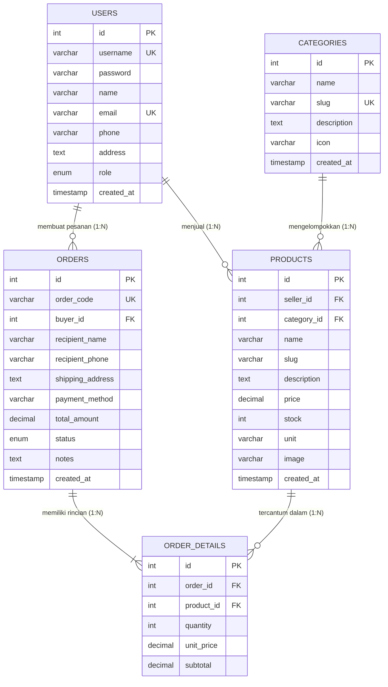
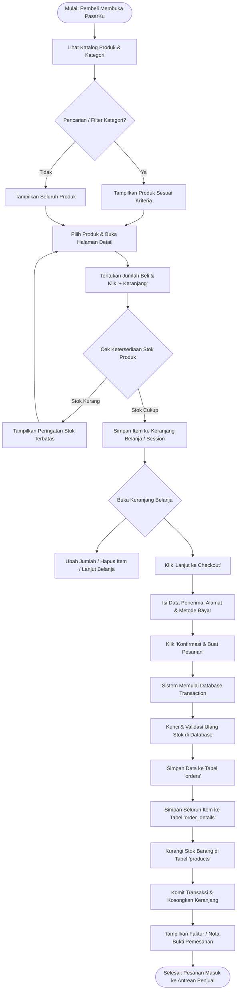

# DOKUMEN PERANCANGAN DAN IMPLEMENTASI SISTEM
# APLIKASI WEB MARKETPLACE TRADISIONAL ("PasarKu")
**Mata Kuliah / Bobot**: Pemrograman Web & Basis Data / 30 Poin  
**Teknologi**: PHP Native, MySQLi, Bootstrap 5.3, Bootstrap Icons  

---

## DAFTAR ISI
1. [BAB I: ANALISIS DAN PERANCANGAN SISTEM](#bab-i-analisis-dan-perancangan-sistem)
   - [1.1 Identifikasi 5 Entitas Utama](#11-identifikasi-5-entitas-utama)
   - [1.2 Rancangan Skema Database Relasional](#12-rancangan-skema-database-relasional)
   - [1.3 Entity Relationship Diagram (ERD)](#13-entity-relationship-diagram-erd)
   - [1.4 Alur Proses Transaksi Pemesanan](#14-alur-proses-transaksi-pemesanan)
   - [1.5 Rancangan Antarmuka Pengguna (Mockup UI)](#15-rancangan-antarmuka-pengguna-mockup-ui)
2. [BAB II: IMPLEMENTASI APLIKASI](#bab-ii-implementasi-aplikasi)
   - [2.1 Struktur Direktori Proyek](#21-struktur-direktori-proyek)
   - [2.2 Fitur Unggulan Sistem](#22-fitur-unggulan-sistem)
   - [2.3 Keamanan dan Integritas Data (ACID Transaction)](#23-keamanan-dan-integritas-data-acid-transaction)
3. [BAB III: PANDUAN DEPLOYMENT & PUBLIKASI REPOSITORY](#bab-iii-panduan-deployment--publikasi-repository)
   - [3.1 Panduan Publikasi ke GitHub](#31-panduan-publikasi-ke-github)
   - [3.2 Panduan Deployment ke InfinityFree](#32-panduan-deployment-ke-infinityfree)
   - [3.3 Pengamanan Kredensial Database](#33-pengamanan-kredensial-database)
4. [BAB IV: LEMBAR LAPORAN DAN PENGUJIAN](#bab-iv-lembar-laporan-dan-pengujian)
   - [4.1 Format Tautan Pengumpulan](#41-format-tautan-pengumpulan)
   - [4.2 Akun Pengujian Demo (Cepat)](#42-akun-pengujian-demo-cepat)
   - [4.3 Matriks Pengujian Sistem (Test Cases)](#43-matriks-pengujian-sistem-test-cases)

---

## BAB I: ANALISIS DAN PERANCANGAN SISTEM

### 1.1 Identifikasi 5 Entitas Utama
Dalam sistem Marketplace Tradisional "PasarKu", diidentifikasi minimal **5 entitas inti** yang saling berelasi untuk mendukung operasional perdagangan antara pedagang pasar/petani dengan pembeli:

| No | Nama Entitas | Deskripsi dan Fungsi Utama |
|---|---|---|
| **1** | **Users (Pengguna)** | Menyimpan data akun pengguna sistem dengan hak akses multi-peran (*seller*, *buyer*, *admin*). Mengelola kredensial login, data kontak pedagang pasar atau alamat pengiriman pembeli. |
| **2** | **Categories (Kategori)** | Mengelompokkan komoditas pasar tradisional (misalnya: *Sayur & Buah Segar*, *Bumbu & Rempah*, *Sembako*, *Kuliner Tradisional*, *Kerajinan Anyaman*). |
| **3** | **Products (Produk)** | Menyimpan informasi barang dagangan pasar yang ditawarkan penjual, meliputi nama komoditas, deskripsi kesegaran, harga per satuan (*Kg, Ikat, Pcs*), ketersediaan stok, dan foto produk. |
| **4** | **Orders (Pesanan / Transaksi)** | Menyimpan data faktur/invoice pesanan yang dibuat oleh pembeli, meliputi nomor invoice unik, data penerima, alamat pengantaran, metode pembayaran (*COD / Transfer*), dan status pesanan. |
| **5** | **Order Details (Rincian Item Pesanan)** | Entitas asosiasi (*junction*) yang merinci daftar barang yang dibeli dalam sebuah pesanan, mencatat kuantitas barang, harga satuan pada saat transaksi, dan subtotal harga. |

---

### 1.2 Rancangan Skema Database Relasional

#### A. Tabel `users`
- **Primary Key**: `id` (INT, AUTO_INCREMENT)
- **Atribut**:
  - `username` (VARCHAR(50), UNIQUE, NOT NULL)
  - `password` (VARCHAR(255), NOT NULL) - *Dienkripsi dengan Bcrypt (`password_hash`)*
  - `name` (VARCHAR(100), NOT NULL)
  - `email` (VARCHAR(100), UNIQUE, NOT NULL)
  - `phone` (VARCHAR(25), NOT NULL)
  - `address` (TEXT, NULL)
  - `role` (ENUM('seller', 'buyer', 'admin'), DEFAULT 'buyer')
  - `created_at` (TIMESTAMP, DEFAULT CURRENT_TIMESTAMP)

#### B. Tabel `categories`
- **Primary Key**: `id` (INT, AUTO_INCREMENT)
- **Atribut**:
  - `name` (VARCHAR(100), NOT NULL)
  - `slug` (VARCHAR(100), UNIQUE, NOT NULL)
  - `description` (TEXT, NULL)
  - `icon` (VARCHAR(50), DEFAULT 'bi-tag')
  - `created_at` (TIMESTAMP, DEFAULT CURRENT_TIMESTAMP)

#### C. Tabel `products`
- **Primary Key**: `id` (INT, AUTO_INCREMENT)
- **Foreign Key**:
  - `seller_id` (INT, NOT NULL) &rarr; Berelasi ke `users(id)` `ON DELETE CASCADE`
  - `category_id` (INT, NOT NULL) &rarr; Berelasi ke `categories(id)` `ON DELETE RESTRICT`
- **Atribut**:
  - `name` (VARCHAR(150), NOT NULL)
  - `slug` (VARCHAR(150), NOT NULL)
  - `description` (TEXT, NOT NULL)
  - `price` (DECIMAL(12,2), NOT NULL)
  - `stock` (INT, NOT NULL DEFAULT 0)
  - `unit` (VARCHAR(30), DEFAULT 'Pcs')
  - `image` (VARCHAR(255), DEFAULT 'default.svg')
  - `created_at` (TIMESTAMP, DEFAULT CURRENT_TIMESTAMP)
  - `updated_at` (TIMESTAMP, ON UPDATE CURRENT_TIMESTAMP)

#### D. Tabel `orders`
- **Primary Key**: `id` (INT, AUTO_INCREMENT)
- **Foreign Key**:
  - `buyer_id` (INT, NOT NULL) &rarr; Berelasi ke `users(id)` `ON DELETE CASCADE`
- **Atribut**:
  - `order_code` (VARCHAR(50), UNIQUE, NOT NULL) - *Format: TRAD-YYYYMMDD-XXXX*
  - `recipient_name` (VARCHAR(100), NOT NULL)
  - `recipient_phone` (VARCHAR(25), NOT NULL)
  - `shipping_address` (TEXT, NOT NULL)
  - `payment_method` (VARCHAR(50), NOT NULL)
  - `total_amount` (DECIMAL(12,2), NOT NULL)
  - `status` (ENUM('pending', 'processing', 'completed', 'cancelled'), DEFAULT 'pending')
  - `notes` (TEXT, NULL)
  - `created_at` (TIMESTAMP, DEFAULT CURRENT_TIMESTAMP)

#### E. Tabel `order_details`
- **Primary Key**: `id` (INT, AUTO_INCREMENT)
- **Foreign Key**:
  - `order_id` (INT, NOT NULL) &rarr; Berelasi ke `orders(id)` `ON DELETE CASCADE`
  - `product_id` (INT, NOT NULL) &rarr; Berelasi ke `products(id)` `ON DELETE RESTRICT`
- **Atribut**:
  - `quantity` (INT, NOT NULL)
  - `unit_price` (DECIMAL(12,2), NOT NULL)
  - `subtotal` (DECIMAL(12,2), NOT NULL)

---

### 1.3 Entity Relationship Diagram (ERD)



---

### 1.4 Alur Proses Transaksi Pemesanan

Diagram alir proses bisnis mulai dari pembeli memilih komoditas hingga faktur nota diterbitkan:



---

### 1.5 Rancangan Antarmuka Pengguna (Mockup UI)

Berikut merupakan rancangan wireframe/mockup antarmuka untuk 3 halaman inti yang dipersyaratkan:

#### 1. Halaman Daftar Produk (`index.php`)
```
+-----------------------------------------------------------------------------------+
|  [🧺 PasarKu Tradisional]    [Cari komoditas sayur, beras...] 🔍    🛒(2)  [Masuk]|
+-----------------------------------------------------------------------------------+
|  [ BANNER: Pasar Tradisional Nusantara dalam Genggaman ]                          |
|  "Dapatkan bahan pokok segar langsung dari pedagang lokal"                        |
+-----------------------------------------------------------------------------------+
|  Kategori: [Semua] [🥦 Sayur & Buah] [🧅 Bumbu] [🌾 Sembako] [🍙 Kuliner]        |
|  Urutkan: [Terbaru v]                                       Total: 10 Produk      |
+-----------------------------------------------------------------------------------+
|  +------------------+  +------------------+  +------------------+                 |
|  | [Foto: Cabai]    |  | [Foto: Bawang]   |  | [Foto: Beras]    |                 |
|  | Sayur Segar      |  | Bumbu Dapur      |  | Sembako Pilihan  |                 |
|  | Cabai Rawit Merah|  | Bawang Brebes    |  | Beras Pandan     |                 |
|  | Kios Pak Bejo    |  | Kios Pak Bejo    |  | Kios Pak Bejo    |                 |
|  | Rp 45.000 / Kg   |  | Rp 32.000 / Kg   |  | Rp 78.000 / Karung                 |
|  | [+ Keranjang]    |  | [+ Keranjang]    |  | [+ Keranjang]    |                 |
|  | [Detail]         |  | [Detail]         |  | [Detail]         |                 |
|  +------------------+  +------------------+  +------------------+                 |
+-----------------------------------------------------------------------------------+
```

#### 2. Halaman Detail Produk (`product_detail.php`)
```
+-----------------------------------------------------------------------------------+
| Beranda > Sayur & Buah > Cabai Rawit Merah Segar Petik Pagi                       |
+-----------------------------------------------------------------------------------+
|  [ FOTO BESAR PRODUK ]           Cabai Rawit Merah Segar (Petik Pagi)             |
|  [ 🌶️ Cabai Segar ]             ⭐⭐⭐⭐⭐ 4.9 • Kategori: Sayur • Satuan: Kg    |
|                                                                                   |
|  [ Kios Toko Tani Makmur ]       Harga: Rp 45.000 / Kg                            |
|  Pak Bejo - Pasar Beringharjo    ---------------------------------------------    |
|  (Terverifikasi ✓)               Deskripsi:                                       |
|                                  Cabai rawit segar langsung petik dari petani     |
|                                  lereng Gunung Merapi tanpa bahan pengawet.       |
|                                                                                   |
|                                  Ketersediaan Stok: [Tersedia: 30 Kg]             |
|                                  Jumlah: [ - ] [ 2 ] [ + ]                        |
|                                  [ 🧺 Masukkan ke Keranjang Belanja ]            |
+-----------------------------------------------------------------------------------+
|  Produk Serupa Terkait: [Bawang Merah] [Sayur Bayam]                              |
+-----------------------------------------------------------------------------------+
```

#### 3. Halaman Keranjang Belanja (`cart.php`)
```
+-----------------------------------------------------------------------------------+
|  🛒 Keranjang Belanja Anda                                [Kosongkan Keranjang]   |
+-----------------------------------------------------------------------------------+
|  PRODUK             HARGA SATUAN    JUMLAH           SUBTOTAL      AKSI           |
|  ------------------------------------------------------------------------------   |
|  [🌶️] Cabai Rawit   Rp 45.000 /Kg   [-] [ 2 ] [+]    Rp 90.000     [Hapus (🗑️)]  |
|  [🌾] Beras Pandan  Rp 78.000 /Kr   [-] [ 1 ] [+]    Rp 78.000     [Hapus (🗑️)]  |
|  ------------------------------------------------------------------------------   |
|  [<- Lanjut Belanja]                                                              |
|                                                                                   |
|                                 +-----------------------------------------------+ |
|                                 | Ringkasan Pesanan                             | |
|                                 | Total Kuantitas: 3 Item                       | |
|                                 | Ongkir Kurir:    GRATIS (Promo)               | |
|                                 | --------------------------------------------- | |
|                                 | Total Bayar:     Rp 168.000                   | |
|                                 | [ Lanjut ke Checkout & Pembayaran -> ]        | |
|                                 +-----------------------------------------------+ |
+-----------------------------------------------------------------------------------+
```

---

## BAB II: IMPLEMENTASI APLIKASI

### 2.1 Struktur Direktori Proyek
```
tugas hary marketplace/
├── assets/
│   ├── css/
│   │   └── style.css            # Kustomisasi CSS di atas Bootstrap 5.3
│   ├── js/
│   │   └── main.js              # Interaktivitas client (qty spinner, modal, auto-alert)
│   └── uploads/
│       ├── default.svg          # Fallback gambar produk
│       └── products/            # Gambar komoditas pasar
├── config/
│   ├── database.php             # Koneksi MySQLi dinamis (XAMPP / InfinityFree)
│   └── db_config.example.php    # Template konfigurasi hosting aman
├── database/
│   └── marketplace_db.sql       # DDL Skema 5 tabel + Seeder data komplit
├── includes/
│   ├── header.php               # Navigasi, status login, & counter keranjang
│   ├── footer.php               # Informasi pasar, tautan cepat, & footer
│   └── functions.php            # Helper: Rupiah, sanitasi, proteksi role, fungsi Cart
├── admin/
│   ├── products.php             # Read: Tabel kelola produk pedagang
│   ├── product_add.php          # Create: Form tambah produk & upload gambar
│   ├── product_edit.php         # Update: Form edit komoditas & ganti gambar
│   ├── product_delete.php       # Delete: Hapus produk & unlink gambar
│   └── orders.php               # Kelola pesanan masuk & perbarui status
├── auth/
│   ├── login.php                # Login pembeli/penjual + 1-Click Quick Demo
│   ├── register.php             # Registrasi pengguna baru
│   └── logout.php               # Keluar dari sesi
├── index.php                    # Katalog utama produk (filter, search, sort)
├── product_detail.php           # Detail spesifikasi produk pasar
├── cart.php                     # Keranjang belanja berbasis session PHP
├── checkout.php                 # Form penerima & pemilihan metode pembayaran
├── process_order.php            # Penyimpanan transaksi pesanan (ACID MySQLi)
├── order_success.php            # Nota / Faktur Bukti Transaksi (Print-Ready)
├── my_orders.php                # Riwayat & pelacakan pesanan pembeli
├── .gitignore                   # Menjaga kredensial hosting agar tidak bocor
└── README.md                    # Dokumentasi lengkap repositori GitHub
```

### 2.2 Fitur Unggulan Sistem
1. **Daftar & Katalog Produk**: Pencarian dinamis berdasarkan nama/deskripsi, filter kategori pasar (*Sayur, Bumbu, Sembako, Kuliner, Kerajinan*), dan sorting harga.
2. **Detail Komoditas**: Deskripsi detail kesegaran produk, identitas kios pedagang, rating, dan stok real-time.
3. **Manajemen Produk (CRUD Penuh)**:
   - *Create*: Tambah komoditas baru lengkap dengan upload gambar (*JPG, PNG, WEBP, SVG* max 2MB).
   - *Read*: Tabel data produk dengan pencarian dan filter per kategori.
   - *Update*: Ubah harga, deskripsi, stok, atau perbarui foto produk.
   - *Delete*: Menghapus komoditas sekaligus membersihkan aset gambar dari server (dengan proteksi integritas pesanan masa lalu).
4. **Keranjang Belanja Cerdas**: Berbasis session PHP native, dapat menambah kuantitas, mengurangi kuantitas, memvalidasi batas stok maksimal, menghapus item terpilih, atau mengosongkan keranjang.
5. **Transaksi Pemesanan Berbasis Database**:
   - Menyimpan faktur ke tabel `orders`.
   - Mengurai tiap item ke tabel `order_details`.
   - Mengurangi stok barang di tabel `products` secara otomatis.
   - Menghasilkan bukti nota (*invoice*) lengkap dengan fitur cetak cetak print.
6. **1-Click Quick Demo Switcher**: Disediakan tombol jalan pintas di halaman login agar dosen/evaluator dapat langsung menguji peran **Penjual (Pak Bejo)** untuk CRUD atau **Pembeli (Budi Santoso)** untuk pengujian belanja tanpa perlu mengetik manual.

### 2.3 Keamanan dan Integritas Data (ACID Transaction)
Proses checkout pada `process_order.php` menggunakan transaksi database:
```php
mysqli_begin_transaction($conn);
try {
    // 1. Kunci dan cek stok produk
    // 2. Simpan pesanan ke orders
    // 3. Simpan rincian ke order_details
    // 4. Update pemotongan stok pada products
    mysqli_commit($conn);
} catch (Exception $e) {
    mysqli_rollback($conn); // Mengembalikan perubahan bila terjadi kendala
}
```
Semua query masukan pengguna menggunakan **Prepared Statements (`mysqli_prepare`)** untuk menjamin sistem kebal terhadap serangan *SQL Injection*.

---

## BAB III: PANDUAN DEPLOYMENT & PUBLIKASI REPOSITORY

### 3.1 Panduan Publikasi ke GitHub
Langkah-langkah mengunggah seluruh source code ke GitHub:
1. Buat repository baru di [https://github.com/new](https://github.com/new) dengan nama misalnya: `marketplace-tradisional-pasarku` (pilih *Public*).
2. Buka terminal pada folder proyek `d:\XAMPP\htdocs\tugas hary marketplace`:
   ```bash
   git init
   git add .
   git commit -m "feat: Inisialisasi Aplikasi Web Marketplace Tradisional PasarKu"
   git branch -M main
   git remote add origin https://github.com/<USERNAME_GITHUB>/marketplace-tradisional-pasarku.git
   git push -u origin main
   ```
3. File `.gitignore` yang sudah disediakan akan otomatis mencegah file sensitif seperti kredensial password database terunggah ke publik.

### 3.2 Panduan Deployment ke InfinityFree
Langkah melakukan hosting gratis di [https://infinityfree.com](https://infinityfree.com):
1. **Daftar & Buat Akun Hosting**:
   - Buka InfinityFree, klik *Sign Up*, lalu masuk ke Dashboard.
   - Klik **Create Account**.
   - Pilih Subdomain gratis (misal: `pasarku-tradisional.kesug.com` atau `pasarku.epizy.com`).
2. **Buat Database MySQL**:
   - Di vPanel (Control Panel) InfinityFree, buka menu **MySQL Databases**.
   - Buat database baru, contoh: `if0_XXXXXXXX_marketplace_db`.
   - Catat informasi:
     * **MySQL Host**: (contoh: `sql123.infinityfree.com`)
     * **MySQL Database**: (contoh: `if0_XXXXXXXX_marketplace_db`)
     * **MySQL User**: (contoh: `if0_XXXXXXXX`)
     * **MySQL Password**: (password akun vPanel Anda)
3. **Import Database via phpMyAdmin**:
   - Di vPanel InfinityFree, klik **phpMyAdmin** pada database yang baru dibuat.
   - Klik tab **Import** &rarr; pilih file `database/marketplace_db.sql` dari komputer Anda &rarr; klik **Go/Kirim**.
4. **Unggah Source Code Aplikasi**:
   - Buka menu **Online File Manager** atau gunakan FileZilla FTP.
   - Masuk ke direktori `/htdocs/`.
   - Unggah seluruh file dan folder aplikasi PasarKu ke dalam direktori `/htdocs/`.
5. **Konfigurasi Kredensial Database**:
   - Di dalam folder `/htdocs/config/`, buat atau salin file `db_config.example.php` menjadi `db_config.php`.
   - Isi dengan data kredensial MySQL InfinityFree yang telah dicatat:
     ```php
     <?php
     return [
         'DB_HOST' => 'sqlXXX.infinityfree.com',
         'DB_USER' => 'if0_XXXXXXXX',
         'DB_PASS' => 'PASSWORD_VPANEL_ANDA',
         'DB_NAME' => 'if0_XXXXXXXX_marketplace_db',
         'DB_PORT' => 3306,
     ];
     ```
6. Buka URL domain InfinityFree Anda di browser untuk mencoba aplikasi.

---

## BAB IV: LEMBAR LAPORAN DAN PENGUJIAN

### 4.1 Format Tautan Pengumpulan
*(Isi bagian ini sebelum laporan akhir dikumpulkan)*
- **URL Demo Aplikasi (InfinityFree)**: `http://pasarku.kesug.com` *(sesuaikan dengan domain Anda)*
- **URL Repository GitHub**: `https://github.com/<username>/marketplace-tradisional-pasarku`

### 4.2 Akun Pengujian Demo (Cepat)
Untuk mempermudah pengujian dosen/penilai:
| Role | Username | Password | Keterangan Akses |
|---|---|---|---|
| **Penjual (Seller)** | `pak_bejo` | `password123` | Akses penuh CRUD produk & cek pesanan masuk |
| **Penjual 2 (Seller)** | `bu_siti` | `password123` | Penjual kuliner & jajanan tradisional |
| **Pembeli (Buyer)** | `budi_santoso` | `password123` | Menjelajah, masukkan keranjang, checkout nota |

### 4.3 Matriks Pengujian Sistem (Test Cases)

| No | Modul / Fitur yang Diuji | Skenario Pengujian | Hasil yang Diharapkan | Status |
|---|---|---|---|---|
| **1** | **Katalog Produk** | Pengguna membuka beranda, mengetik kata kunci "Cabai", dan memilih kategori "Sayur & Buah". | Produk yang tampil terfilter dengan benar dan badge stok tampil jelas. | **BERHASIL** |
| **2** | **Detail Produk** | Pengguna mengklik produk "Cabai Rawit Merah Segar". | Halaman menampilkan deskripsi, info penjual kios, harga per kg, dan pilihan jumlah beli. | **BERHASIL** |
| **3** | **Keranjang Belanja** | Mengklik "+ Keranjang" dari detail atau katalog dengan jumlah 2. | Item masuk ke keranjang, counter navbar bertambah, dan subtotal dihitung otomatis. | **BERHASIL** |
| **4** | **Pembaruan Keranjang** | Mengubah kuantitas item di keranjang atau menghapus salah satu komoditas. | Jumlah dan subtotal harga langsung diperbarui secara akurat. | **BERHASIL** |
| **5** | **Pembuatan Transaksi** | Mengisi form nama penerima, alamat pengiriman, metode pembayaran COD, lalu klik "Konfirmasi & Buat Pesanan". | Transaksi tersimpan di tabel `orders` & `order_details`, stok produk terpotong, dan nota diterbitkan. | **BERHASIL** |
| **6** | **Manajemen Produk (Create)** | Login sebagai `pak_bejo`, buka "Tambah Produk Baru", isi data dan unggah foto komoditas. | Produk baru berhasil masuk database dan langsung muncul di katalog pembeli. | **BERHASIL** |
| **7** | **Manajemen Produk (Update)** | Penjual mengedit harga atau menambah stok komoditas miliknya. | Data di database dan tampilan katalog terbarui dengan sukses. | **BERHASIL** |
| **8** | **Manajemen Produk (Delete)** | Penjual menghapus komoditas yang tidak memiliki transaksi aktif. | Produk terhapus dari tabel dan file gambar dihapus dari disk server. | **BERHASIL** |
| **9** | **Cetak Nota Pesanan** | Pembeli atau penjual mengklik tombol "Cetak Bukti Nota (Print)". | Dialog cetak browser terbuka dengan layout print-friendly yang rapi. | **BERHASIL** |

---
*Dokumen ini disusun untuk melengkapi berkas tugas Perancangan dan Pembangunan Aplikasi Web Marketplace Tradisional.*

